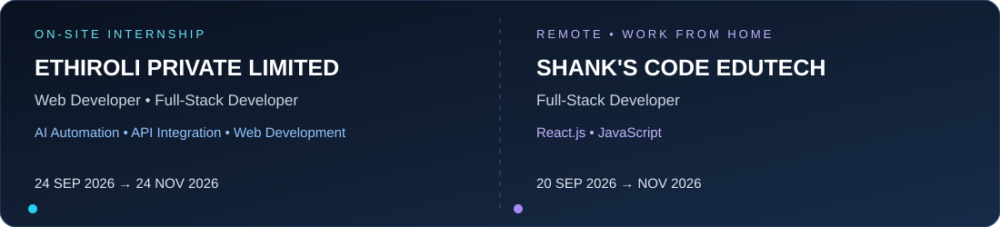

<!--
  LOGANATHAN | GitHub Profile README
  Built from the technologies and projects documented in your public repositories.
-->

  

  

  

    
    
    
  

  

---

## 👨‍💻 About Me

Hi! I'm **Loganathan**, a final-year **B.Tech Artificial Intelligence & Data Science** student at Mahendra Engineering College, Tamil Nadu, India.

I enjoy turning ideas into practical software — from AI-powered applications and computer-vision experiments to interactive web experiences, full-stack platforms and workflow automation.

- 🎓 Studying Artificial Intelligence & Data Science
- 🤖 Interested in AI, machine learning, deep learning and computer vision
- 🌐 Building web applications and full-stack solutions
- 🧩 Learning by creating, experimenting and improving real projects
- ⚙️ Building automations and integrations with n8n, Supabase, SQL and APIs\n- 🛠️ Tools I use: VS Code, Eclipse, Git and GitHub\n- 🌱 I continuously explore and learn new tools, technologies and workflows as projects require.

---

## 🧰 Tech Stack & Tools

*Technologies represented in my project repositories and documented project work.*

### Programming & Web Languages

### Frontend Development

### Databases & Backend Services

 

### Automation & Integrations

AI-powered workflow automation with n8n 
WhatsApp messaging integration and chatbot workflows 
Supabase and SQL database workflows 
REST API usage and integration

### Developer Tools & Platforms

Website and web application development 
AI tools for development, research and productivity

---

---

## 💼 Internship Experience

### Ethiroli Private Limited — On-site
**Web Developer & Full-Stack Developer** · 24 September 2026 – 24 November 2026

Worked on web development and full-stack tasks, including AI automation workflows and integrations, frontend, backend and API integration.

### Shank's Code Edutech — Remote
**Full-Stack Developer** · 20 September 2026 – November 2026

Worked remotely on full-stack web development using **React.js and JavaScript**.

## 🔄 What I Do

| Process | What I work on |
|---|---|
| 💡 Understand | Break a real-world requirement into clear features |
| 🧭 Plan | Map user journeys, data flow and automation steps |
| 🧑‍💻 Develop | Build web interfaces and application features |
| 🔌 Integrate | Connect REST APIs, databases and external services |
| 🤖 Automate | Create n8n workflows and chatbot integrations |
| 🧪 Test & Improve | Debug, refine and improve the solution |
| 🚀 Maintain | Update projects and learn better ways to build |

## 🌱 Always Learning & Adapting

Technology keeps changing, and so do I. I actively explore new AI tools, developer platforms, automation services and frameworks, then learn and apply the ones that fit the problem I'm solving.

**My mindset:** Learn continuously · Experiment responsibly · Build practically · Improve consistently.

---

## 🚀 Featured Projects

## 🗂️ Project Portfolio

### 🎓 Academic Projects

| Project | Description & technologies |
|---|---|
| **AI-Powered Disaster Monitoring** | Final-year project concept using satellite and drone imagery for disaster monitoring and analysis |
| [Smart Traffic Management](https://github.com/sloganathan288-dev/smart_traffic_system-management) | AI-based vehicle-density monitoring and traffic signal automation using Python, computer vision and IoT concepts |
| [Academic Performance Analysis](https://github.com/sloganathan288-dev/academic-performance-analysis-system) | Data analysis project focused on academic performance |
| [RNN Voice & Next-Word Prediction](https://github.com/sloganathan288-dev/RNN-voice-and-next-word-prediction) | Speech-to-text and next-word prediction using Flask and LSTM-based deep learning |

### 💡 Personal & Learning Projects

| Project | Description & technologies |
|---|---|
| [LOGU GAMES](https://github.com/sloganathan288-dev/LOGU-GAMES) | Collection of browser games built with React, TypeScript and Vite |
| [Hand Pen](https://github.com/sloganathan288-dev/hand-detection-write) | Webcam hand-detection drawing using JavaScript, MediaPipe Hands and HTML Canvas |
| [Doodle Alive](https://github.com/sloganathan288-dev/doodle-alive) | Browser-based drawing and animation using HTML, CSS, JavaScript and Canvas |
| [Loganathan V2](https://github.com/sloganathan288-dev/loganathan-v2) | AI chat workspace concept with Firebase authentication, Firestore, Storage and a cloud function |
| [Mindfull AI](https://github.com/sloganathan288-dev/mindfull-ai) | AI application exploration |
| **BrainZone IQ Chatbot** | AI chatbot project |
| **Virtual Try-On** | AI-powered virtual try-on project |
| **AI Medicine Reminder** | Flutter and IoT-based medicine reminder application |

### 🏢 Company, Internship & Business Projects

| Project | Description & technologies |
|---|---|
| **Ethiroli – Employee & Company Platform** | Contributed to a multi-role company platform, working on assigned modules, bug fixes and feature improvements. React frontend and backend API integration; work shared through GitHub pull requests. This project is not yet published in my GitHub repositories. |
| **Durga Jothidham – Appointment Assistant** | Astrology appointment chatbot workflow using n8n Cloud, WhatsApp Cloud API (planned production channel), Gemini and Supabase/PostgreSQL. A Telegram demo was also developed to test Tamil booking conversations, service menus and appointment flow. |
| [VETRI KALAM Sports & Events](https://github.com/sloganathan288-dev/vetri-kalam-sports-events) | Sports event website and registration platform with React, PostgreSQL, serverless APIs and organiser tools |
| [LOGAN IT Solutions](https://github.com/sloganathan288-dev/logan-it-solutions) | Business website and platform with PostgreSQL, payment workflows, APIs and admin features |
| [Personal Portfolio](https://github.com/sloganathan288-dev/loganathan-portfolio) | React, Vite and TypeScript developer portfolio |

*Some academic and personal projects above are documented from my project work but are not yet published as separate GitHub repositories. Project status and implementation details may evolve as development continues.*

---

## 📊 GitHub Analytics

  
  
   
  
   
  

---

## 🎯 Currently Focused On

- Building practical AI-powered applications and automation workflows
- Exploring n8n, WhatsApp API integrations and Supabase
- Continuously learning and adapting to useful new developer tools and technologies
- Improving full-stack development and software architecture
- Exploring machine learning and computer vision
- Writing cleaner, more maintainable code
- Growing through consistent project work and collaboration

---

## 🤝 Let's Connect

I'm always interested in learning, collaborating and building useful technology.

**“Build with curiosity. Improve with consistency. Create with purpose.”**

